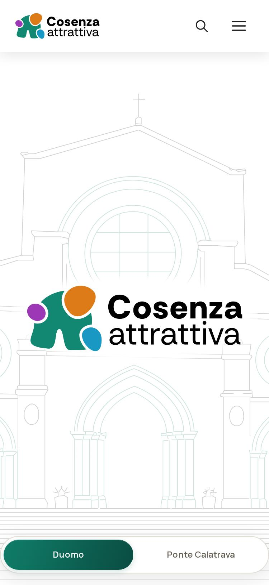
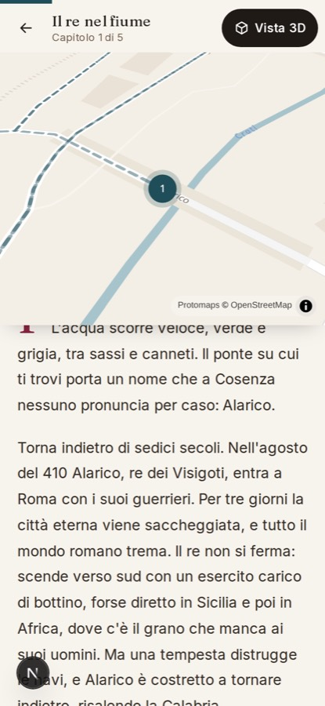
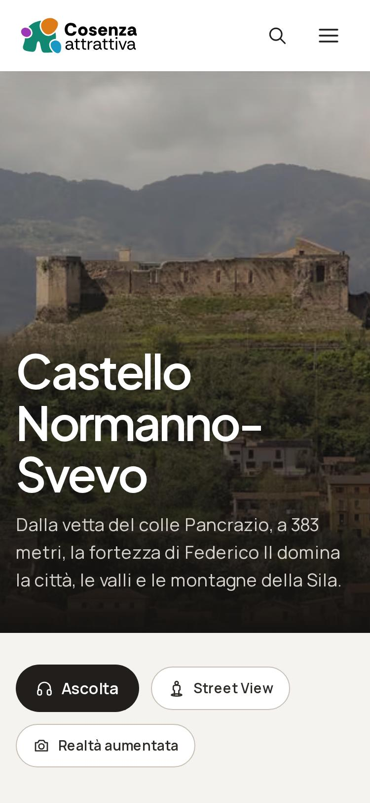
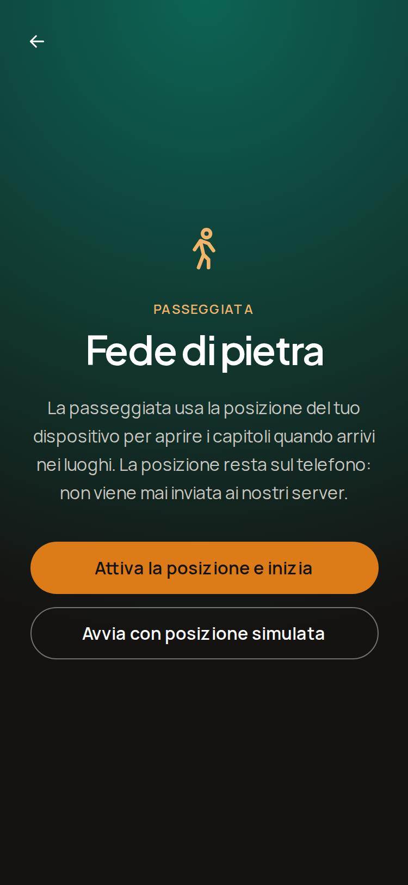

# Cosenza attrattiva – Itinerari narrativi

Web app mobile-first per vivere gli itinerari di Cosenza come un racconto a capitoli:
mappa e narrazione si muovono insieme, la passeggiata si attiva quando arrivi nei luoghi.
Demo per il Comune di Cosenza, masterplan *Cosenza Città Attrattiva* – pilastro **Connect** (turismo).

- **Racconto**: scrollytelling con la mappa che vola di tappa in tappa e disegna il percorso fatto/rimanente
- **Passeggiata**: geofencing, bussola, narrazione vocale all'arrivo, timbri del Passaporto
- **Scheda luogo**: galleria, "Ieri e oggi", curiosità, orari e accessibilità, itinerari collegati
- **PWA** installabile con download offline dell'itinerario (testi, foto, mappa)
- **IT / EN**, WCAG 2.1 AA, nessun tracciamento della posizione
- **Home "Cosenza attrattiva"** sull'impianto grafico di vivi-cosenza: intro con il Duomo disegnato allo scroll,
  mission del masterplan con le tre aree **Vive / Connect / Crea**, pannelli MAB–Duomo–San Domenico, "tre modi di
  vivere l'itinerario", itinerari dal database, eventi
- **Fase 2** (feature flag): Street View con hotspot, volo 3D fotorealistico, AR geolocalizzata, "Chiedi a Cosenza"

Documenti: [Architettura](docs/ARCHITECTURE.md) · [Scaletta della demo](docs/DEMO-SCRIPT.md) ·
[Design token](docs/DESIGN-TOKENS.md) · [Analisi di vivi-cosenza](docs/reference/vivicosenza/ANALISI.md) ·
[Confronto visivo](docs/reference/compare/) · [Coordinate da verificare](TODO-coordinate.md) · [Asset mappa](scripts/map/README.md)

<p>
  
  
  
  
</p>

## Copia di lavoro "sintesi" (fasi 1 e 2)

Questi branch (`feat/sintesi-fase1`, poi `feat/sintesi-fase2`) è la copia di lavoro della proposta di sintesi con il prototipo
"Città da vivere"; la versione stabile resta sul tag `stabile-2026-11-23` (branch `demo-stabile`).
La copia gira con uno stack Docker separato grazie a `.make.local` e a `COMPOSE_PROJECT_NAME` in `.env`
(non versionati): **https://cosenzaattrattiva.test:8444**, database su `127.0.0.1:5434`.

```make
# .make.local della copia
HTTP_PORT := 8081
HTTPS_PORT := 8444
export DB_HOST_PORT := 5434
export COMPOSE_PROJECT_NAME := cosenzasintesi
```

Novità della fase 1:

| Area | Cosa | Dove |
|---|---|---|
| Hero | Selettore **Antica / Contemporanea**, claim "Cosenza, città da vivere." sotto il logo | `components/home/SilhouetteIntro` |
| Vive | Eventi nel database: **grandi eventi** (rilevanza, pagina dedicata) e **calendario** con filtri | `/eventi`, `/eventi/[slug]`, tabella `events`, `content/seed/events.ts` |
| Crea | Pagina **Fatto a Cosenza**: mestieri, marchio, botteghe, eventi dell'artigianato | `/fatto-a-cosenza` |
| Connect | Pagina **Ritorno a Cosenza** (turismo delle radici, IT/EN) | `/ritorno-a-cosenza` |
| Itinerari | Tipi **a piedi / misto / tematico**: tappe con `at: null` senza posizione | `content/seed/types.ts`, esempi `le-mani-di-cosenza`, `ritorno-a-cosenza` |
| Menu | Sottomenu dei pilastri (desktop e mobile) | `components/layout/NavDropdown` |

Tutti gli eventi sono **dati dimostrativi** (`demo: true`) da verificare con il Comune.

Novità della fase 2:

| Area | Cosa | Dove |
|---|---|---|
| Esplora | Elenco + mappa di tutti i luoghi, filtri (Arte e storia, Piazze e quartieri, Gusto, Natura e panorami), pilastro, minuti a piedi stimati da Piazza dei Bruzi | `/esplora`, `lib/explore.ts` |
| Il mio itinerario | Cuore sulle schede (Esplora e luogo), pannello nell'header con contatore: ordine, rimozione, **Condividi su WhatsApp**, svuota. Solo `localStorage` | `components/mine`, `lib/stores/my-itinerary.ts` |
| Condivisione | Link `/mio-itinerario?p=slug1,slug2`: chi lo riceve vede le tappe, le salva o le percorre | `/mio-itinerario` |
| Passeggiata personale | Stessa passeggiata degli itinerari (geofence, audio), percorso in linea retta tra le tappe; servono ≥ 2 tappe | `/mio-itinerario/passeggiata?p=…` |
| Passaporto | Messo da parte: `NEXT_PUBLIC_FEATURE_PASSPORT=false` (default) nasconde timbri, check-in e link; `/passaporto` → 404 | `lib/env.ts` |

Pilastro dei luoghi in Esplora: strade e piazze → Vive, cantine → Crea, il resto → Connect.
I minuti a piedi sono una **stima** (linea d'aria × 1,3 a 75 m/min).

## Requisiti

- Docker Desktop (Compose v2)
- [mkcert](https://github.com/FiloSottile/mkcert) – `brew install mkcert nss`
- Porte libere sull'host per il proxy (vedi [Porte del proxy](#porte-del-proxy))

## Avvio rapido

```bash
make setup   # certificati mkcert, /etc/hosts (con conferma), stack, migrazioni, seed
make up      # avvio quotidiano
```

Apri l'URL stampato da `make up` (con le porte standard **https://cosenzaattrattiva.test**, oggi
**https://cosenzaattrattiva.test:8443**, vedi [Porte del proxy](#porte-del-proxy)): il lucchetto deve essere
valido, senza avvisi.

| Comando | Cosa fa |
|---|---|
| `make setup` | Prima installazione completa (idempotente) |
| `make up` / `make down` | Avvia / ferma lo stack (i dati restano nei volumi) |
| `make logs` | Log in tempo reale (`make logs s=app` per un solo servizio) |
| `make seed` | Popola il DB con i contenuti di Cosenza (idempotente) |
| `make reset-db` | Cancella e ricrea il DB (migrazioni + seed) |
| `make migrate` | Applica le migrazioni Drizzle |
| `make sh` / `make psql` | Shell nel container app / console Postgres |
| `make typecheck` / `make lint` | Controlli statici |
| `make test` | Test unitari Vitest (geo, geofence, WKB) |
| `make e2e` | Test Playwright (mobile 375px + desktop) contro il dominio HTTPS |
| `make prod-local` | Build di produzione servita dallo stesso proxy (per Lighthouse) |
| `make lighthouse` | Lighthouse mobile su home, itinerario e luogo (`LH_PATHS="/it"` per una sola pagina) |
| `make reference` | Analisi del sito di riferimento vivi-cosenza (protetto: `REF_PASSWORD` o `REF_COOKIE` in `.env`) |
| `make compare` | Screenshot della home per il confronto con vivi-cosenza (`w=375,768,1440`), poi `python3 scripts/reference/compose-compare.py` |
| `make dns` | DNS locale per testare da smartphone in LAN |
| `make help` | Elenco completo |

## Architettura locale

```
browser ──HTTPS──▶ proxy (Caddy, :80→:443, cert mkcert)
                     │  WebSocket HMR, X-Forwarded-*
                     ▼
                   app (Next.js dev, Turbopack, hot reload)
                     │
                     ▼
                   db (PostgreSQL 17 + PostGIS 3.5, volume persistente)
```

- **Caddy** (scelto al posto di Traefik): con un solo upstream e un certificato statico
  basta un Caddyfile di poche righe; redirect HTTP→HTTPS, WebSocket e header
  `X-Forwarded-*` sono gestiti di default. In produzione la stessa configurazione ottiene
  certificati ACME reali cambiando una riga.
- **app**: codice in bind mount, `node_modules` e `.next` in volumi Docker (dipendenze Linux
  native, I/O veloce su macOS). Le dipendenze si reinstallano da sole quando cambia il lockfile.
- **db**: immagine `imresamu/postgis` (build multi-arch di `postgis/postgis`, funziona anche su
  Apple Silicon). Esposto solo su `127.0.0.1:5433` per strumenti dall'host.
- `docker/app/Dockerfile` è il **Dockerfile multi-stage di produzione** (output standalone),
  separato da `Dockerfile.dev`.

## Qualità

| Controllo | Comando | Stato |
|---|---|---|
| Test unitari (geo, geofence con isteresi, WKB) | `make test` | 23 ✔ |
| E2E Playwright, mobile 375px + desktop, contro il dominio HTTPS con CA verificata dal browser | `make e2e` | 36 ✔ |
| E2E sulla build di produzione, incluso offline | `make prod-local && make e2e-prod` | 37 ✔ |
| Accessibilità axe WCAG 2.1 AA (home, itinerario, luogo, Esplora, Il mio itinerario; passaporto se attivo) | incluso in `make e2e` | 0 violazioni gravi |
| Lighthouse mobile (build di produzione, container dev fermo) | `make prod-local && make lighthouse` | Performance 94–97, Accessibility 100, Best practices 100, SEO 100 |
| Typecheck / lint | `make typecheck` / `make lint` | ✔ |

Il container e2e (`docker/e2e`) registra la CA mkcert nell'NSS di Chromium: i test non ignorano gli errori TLS.

Lighthouse su Docker Desktop è sensibile al carico della macchina: misurare dopo `docker compose stop app`
(il container dev compete per la CPU) e scartare il primo giro dopo una build.

## Home e design system

La home riprende struttura, tipografia (Plus Jakarta Sans + Manrope, self-hosted in `src/fonts/`),
spaziature ed effetti di vivi-cosenza, con il marchio e la palette di Cosenza attrattiva
([design token](docs/DESIGN-TOKENS.md), contrasti AA verificati). Gli effetti allo scroll sono porting
fedeli del sito di riferimento (`src/components/home/effects/`) e si disattivano con `prefers-reduced-motion`.

| Sezione | Componente | Dati |
|---|---|---|
| Header e menu Vive / Connect / Crea | `layout/Header`, `HeaderMenu`, `PillarIcon` | — |
| Intro silhouette (Duomo / Ponte Calatrava) | `home/SilhouetteIntro`, `effects/silhouette.ts` | disegni in `public/home/` (ottimizzati con `scripts/optimize-silhouette.mjs`), testi in `messages` |
| Mission e tre aree | `home/MissionSection`, `PillarCarousel` | testi dal masterplan (`materiale/`) |
| Pannelli MAB, Duomo, San Domenico | `home/HomeHero` (`HomePanels`), `effects/panels.ts` | luoghi dal DB |
| Tre modi di vivere l'itinerario | `home/ThreeWays`, `effects/lower.ts` | foto dal DB |
| Itinerari | `home/ItinerariesSection`, `ItineraryCarousel` | 7 itinerari dal DB |
| Eventi | `home/EventsSection`, `EventCard` | `src/content/events.ts` (**dati dimostrativi**) |
| Footer | `layout/Footer` | recapiti del Comune |

## Contenuti

I contenuti sono file TypeScript tipizzati in `content/seed/` (luoghi, itinerari con capitoli IT/EN,
media con crediti, quartieri). `make seed` li valida e li carica in modo idempotente.

- **Foto**: Wikimedia Commons con licenze libere; autore e licenza sono nella tabella `media` e nella pagina
  `/crediti`.
- **Percorsi**: tracciati pedonali reali calcolati una tantum con OSRM (`docker compose exec app pnpm routes`)
  e salvati in `content/seed/routes/`, così il seed funziona offline.
- **Coordinate**: verificate su Wikidata/OSM dove possibile; le altre sono elencate in `TODO-coordinate.md`.

### Variabili d'ambiente

Copia `.env.example` in `.env` (lo fa `make setup`). Le variabili non impostate usano i default
di `docker-compose.yml`. `NEXT_PUBLIC_GOOGLE_MAPS_API_KEY` è opzionale: senza chiave l'app usa
solo la mappa open source, nasconde Street View e usa il volo 3D MapLibre.

**Chiave Google**: abilita *Maps JavaScript API* e *Map Tiles API*; restrizione per referrer HTTP con
`https://cosenzaattrattiva.test/*` **e**, finché si usa la porta 8443, `https://cosenzaattrattiva.test:8443/*`.

| Flag | Default |
|---|---|
| `NEXT_PUBLIC_FEATURE_STREETVIEW`, `_3D`, `_AR`, `_ASSISTANT` | `true` |
| `NEXT_PUBLIC_DEMO_TOOLS` (simulatore di posizione) | `true` in dev, impostare `false` in produzione |
| `NEXT_PUBLIC_FLY3D_PROVIDER` (motore del volo 3D) | `google3d` |
| `NEXT_PUBLIC_FEATURE_PASSPORT` (passaporto e timbri) | `false` (copia sintesi) |

**Volo 3D**: il motore si sceglie con `NEXT_PUBLIC_FLY3D_PROVIDER` in `.env`, poi `make up`
(per la build di produzione `make prod-local`, perché la variabile entra nel bundle).

| Valore | Motore | Requisiti |
|---|---|---|
| `google3d` (predefinito) | 3D Maps della Maps JavaScript API, fotorealistico | chiave Google, consenso; disponibile anche per account di fatturazione europei |
| `maplibre` | rilievo (Terrain Tiles locali) ed edifici OSM estrusi | nessuno; funziona offline dopo il primo volo |
| `google` | Photorealistic 3D Tiles (Map Tiles API) con CesiumJS | **non disponibile** per account di fatturazione dello Spazio economico europeo (403, confermato dal supporto Google il 23/11/2026) |

Senza chiave Google si usa comunque `maplibre`.

### Porte del proxy

Le porte sono definite in cima al `Makefile` (`HTTP_PORT` / `HTTPS_PORT`). Attualmente sono
**8080/8443** perché 80/443 sono occupate da un altro stack locale, quindi l'app risponde su
**https://cosenzaattrattiva.test:8443**. Quando le porte standard si liberano:

```bash
make up HTTP_PORT=80 HTTPS_PORT=443     # una tantum, oppure cambia i default nel Makefile
```

`NEXT_PUBLIC_SITE_URL`, redirect HTTP→HTTPS e test e2e si adeguano automaticamente.

## Test da smartphone (LAN)

Geolocalizzazione, bussola e fotocamera funzionano solo in HTTPS, quindi il telefono deve
fidarsi della CA mkcert e risolvere il dominio.

1. **Risolvi il dominio** – `make dns` avvia un DNS (dnsmasq) che punta
   `cosenzaattrattiva.test` all'IP Wi-Fi del Mac; sul telefono imposta quell'IP come DNS
   manuale della rete Wi-Fi. In alternativa aggiungi la voce nel DNS del router.
2. **Installa la CA** – dal telefono apri `http://cosenzaattrattiva.test/dev/rootCA.pem`
   (servito in HTTP apposta) oppure invia `docker/certs/rootCA.pem` via AirDrop/email.
   - iOS: Impostazioni → Profilo scaricato → Installa; poi Generali → Info →
     Impostazioni attendibilità certificati → abilita *mkcert*.
   - Android: Impostazioni → Sicurezza → Crittografia e credenziali → Installa certificato →
     Certificato CA (Chrome accetta le CA utente).
3. Apri **https://cosenzaattrattiva.test** sul telefono.

### Demo da remoto (tunnel)

```bash
cloudflared tunnel --url https://cosenzaattrattiva.test --http-host-header cosenzaattrattiva.test \
  --origin-ca-pool docker/certs/rootCA.pem          # oppure: tailscale funnel
```

Il tunnel fornisce un dominio pubblico con certificato reale: imposta `NEXT_PUBLIC_SITE_URL` su
quell'URL, riavvia (`make up`) e aggiungi il referrer alla chiave Google.
